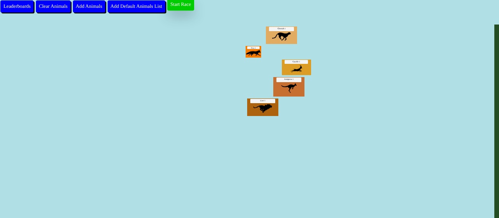

# JavaScript Projects

Browser JavaScript projects from my web development studies. There's no build step: open the `index.html` file in a browser.

## Animal Race — object-oriented JavaScript

A race track where cheetahs, lions, gazelles, foxes and kangaroos compete. Each animal type has its own speed, size and image.

- **Constructor functions and prototype inheritance:** each animal (`Cheetah`, `Lion`, `Gazelle`, `Fox`, `Kangaroo`) inherits from a base `Animal` using `Animal.call(this, …)` and `Object.create(Animal.prototype)`
- **Polymorphism:** every animal overrides `step()` to move in its own way, with randomised timing based on its speed
- A `Race` class (ES6) tracks finishing places and builds a **leaderboard** with gold, silver and bronze rows
- A form to add custom animals with your own colour, step time and size
- **Hovering** over an animal gives it a temporary speed boost
- Buttons to load a default line-up, clear the track and start the race

Built with jQuery for DOM handling. The race was developed from a basic `Animal` and `Lion` starter template, which I extended with the new animal types, the race logic, the leaderboard and the interface.

**Run it:** open `animal-race/index.html`, click **Add Default Animals List**, then **Start Race**.

## Word Guessing Game

A console game for practising JavaScript basics: arrays, loops, conditionals, `prompt`/`alert` and scoring. The player sees a definition and has three attempts to guess the word, earning points for correct answers, and can play again at the end.

**Run it:** open `word-guessing-game/index.html` and keep the browser's developer console open (F12) to read the definitions.
